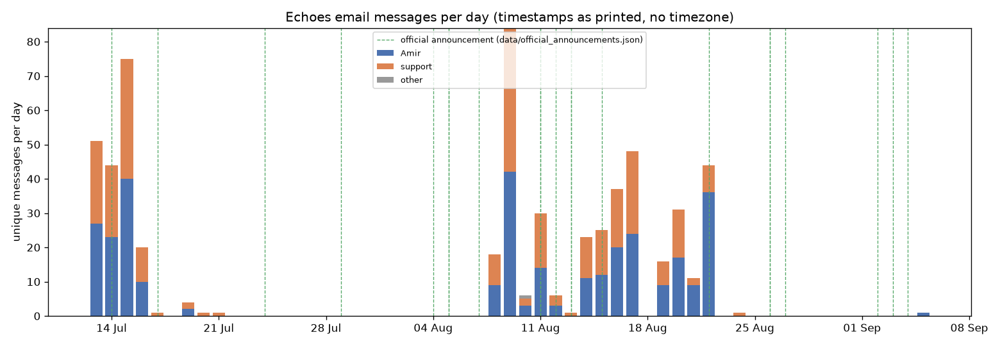
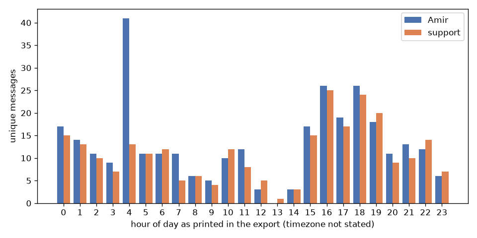
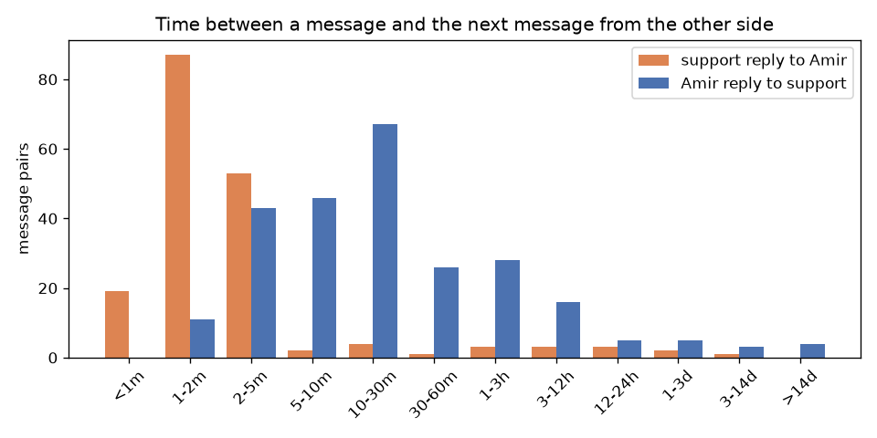

# Temporal analysis of the Echoes email threads

> Generated by [`scripts/temporal_analysis.py`](scripts/temporal_analysis.py). Do not edit by hand: rerun `python3 analysis/scripts/temporal_analysis.py` from the repository root. Every number below is computed by the script; full tables are in [`output/`](output/) and charts in [`figures/`](figures/).

This page describes when messages were sent. Where it places messages next to official announcements it reports counts and day distances only; it makes no claim that any event caused, preceded in importance, or was related to another.

## Method

- Messages: the 579 unique messages produced by [`scripts/threads.py`](scripts/threads.py) (same parsing and de-duplication as [`linguistic.md`](linguistic.md)).
- **Timestamps have no timezone.** Gmail's print view prints each message's date and time (to the minute) without a zone; all exports come from the same Gmail account, so they are treated as one consistent local clock. Calendar-day boundaries, hour-of-day, and 0-1 day distances could shift if the true zone differs.
- Response time = minutes between a message and the next message in the same export when the sender side changes (Amir to support, or support to Amir). Pairs that appear in several exports are counted once. This measures the gap between consecutive messages in the export, not confirmed reply-to links.
- Announcements: the 34 dated entries in [`data/official_announcements.json`](../data/official_announcements.json) (see `timeline/`). Windows are 3 calendar days before and after each announcement date.

## 1. Span and activity

- First message: 2025-07-13T15:05; last message: 2025-09-05T16:14 (as printed).
- Calendar days in that span: 55; days with at least one message: 24 (43.6%).
- Gap between consecutive messages (all sides, minutes): median 4.0, max 25734.

Busiest days:

| date | Amir | support | other | total |
| --- | --- | --- | --- | --- |
| 2025-08-09 | 42 | 42 | 0 | 84 |
| 2025-07-15 | 40 | 35 | 0 | 75 |
| 2025-07-13 | 27 | 24 | 0 | 51 |
| 2025-08-17 | 24 | 24 | 0 | 48 |
| 2025-07-14 | 23 | 21 | 0 | 44 |
| 2025-08-22 | 36 | 8 | 0 | 44 |
| 2025-08-16 | 20 | 17 | 0 | 37 |
| 2025-08-20 | 17 | 14 | 0 | 31 |

Per ISO week:

| ISO week | week starting (Mon) | Amir | support | other | total |
| --- | --- | --- | --- | --- | --- |
| 2025-W28 | 2025-07-07 | 27 | 24 | 0 | 51 |
| 2025-W29 | 2025-07-14 | 75 | 70 | 0 | 145 |
| 2025-W30 | 2025-07-21 | 0 | 1 | 0 | 1 |
| 2025-W32 | 2025-08-04 | 54 | 53 | 1 | 108 |
| 2025-W33 | 2025-08-11 | 84 | 86 | 0 | 170 |
| 2025-W34 | 2025-08-18 | 71 | 32 | 0 | 103 |
| 2025-W36 | 2025-09-01 | 1 | 0 | 0 | 1 |

Quiet periods (consecutive days with no message), longest first (top 10; all in `output/temporal_quiet_periods.csv`):

| first quiet day | last quiet day | days |
| --- | --- | --- |
| 2025-07-22 | 2025-08-07 | 17 |
| 2025-08-25 | 2025-09-04 | 11 |
| 2025-07-18 | 2025-07-18 | 1 |
| 2025-08-18 | 2025-08-18 | 1 |
| 2025-08-23 | 2025-08-23 | 1 |

## 2. Hour of day (as printed)

| hour | 0 | 1 | 2 | 3 | 4 | 5 | 6 | 7 | 8 | 9 | 10 | 11 | 12 | 13 | 14 | 15 | 16 | 17 | 18 | 19 | 20 | 21 | 22 | 23 |
| --- | --- | --- | --- | --- | --- | --- | --- | --- | --- | --- | --- | --- | --- | --- | --- | --- | --- | --- | --- | --- | --- | --- | --- | --- |
| Amir | 17 | 14 | 11 | 9 | 41 | 11 | 11 | 11 | 6 | 5 | 10 | 12 | 3 | 0 | 3 | 17 | 26 | 19 | 26 | 18 | 11 | 13 | 12 | 6 |
| support | 15 | 13 | 10 | 7 | 13 | 11 | 12 | 5 | 6 | 4 | 12 | 8 | 5 | 1 | 3 | 15 | 25 | 17 | 24 | 20 | 9 | 10 | 14 | 7 |

## 3. Response times

Minutes. For "support reply to Amir" the group is the replying sender; for "Amir reply to support" it is the support sender Amir was answering.

| direction | sender group | pairs | median | p25 | p75 | min | max | <=5 min | >24 h |
| --- | --- | --- | --- | --- | --- | --- | --- | --- | --- |
| Amir reply to support | OpenAI from OpenAI | 154 | 8.0 | 4.0 | 16.8 | 1.0 | 49213 | 64 | 3 |
| Amir reply to support | Operator (rating prompts) | 8 | 1923.5 | 127.2 | 18801.8 | 109.0 | 45019 | 0 | 4 |
| Amir reply to support | Support Team / Integration User Quartz | 75 | 40.0 | 17.0 | 124.0 | 2.0 | 20871 | 4 | 5 |
| Amir reply to support | all | 254 | 14.0 | 5.0 | 51.0 | 1.0 | 49213 | 68 | 12 |
| Amir reply to support | named agents (<Name> from OpenAI) | 17 | 30.0 | 18.0 | 106.0 | 11.0 | 373 | 0 | 0 |
| support reply to Amir | OpenAI from OpenAI | 160 | 1.0 | 1.0 | 2.0 | 0.0 | 17 | 159 | 0 |
| support reply to Amir | Operator (rating prompts) | 2 | 1491.5 | 1473.8 | 1509.2 | 1456.0 | 1527 | 0 | 2 |
| support reply to Amir | all | 178 | 1.0 | 1.0 | 2.0 | 0.0 | 5131 | 159 | 3 |
| support reply to Amir | named agents (<Name> from OpenAI) | 16 | 135.0 | 20.2 | 440.5 | 8.0 | 5131 | 0 | 1 |

Second measure, across all exports: for every support message, minutes since Amir's most recent earlier message in any export. This includes case-record exports that open with a support message (the message it answers is in a different export), but it may pair a reply with an Amir message it does not answer.

| support sender group | messages | median | p25 | p75 | min | max | <=5 min | >24 h |
| --- | --- | --- | --- | --- | --- | --- | --- | --- |
| OpenAI from OpenAI | 160 | 1.0 | 1.0 | 2.0 | 0.0 | 17 | 159 | 0 |
| Operator (rating prompts) | 8 | 1130.5 | 493.8 | 1441.2 | 101.0 | 4093 | 0 | 3 |
| Support Team / Integration User Quartz | 81 | 4.0 | 2.0 | 6.0 | 0.0 | 3342 | 54 | 1 |
| all | 266 | 2.0 | 1.0 | 4.0 | 0.0 | 4093 | 215 | 5 |
| named agents (<Name> from OpenAI) | 17 | 47.0 | 15.0 | 385.0 | 5.0 | 2846 | 2 | 1 |

## 4. Activity around official announcements

21 of the 34 announcements fall inside the message span; 9 of those fall on a day with at least one message. For comparison, 43.6% of all days in the span have a message. Counts are unique messages (both sides).

| id | date | org | announcement | in span | msgs 3 d before | msgs same day | msgs 3 d after |
| --- | --- | --- | --- | --- | --- | --- | --- |
| OA-01 | 2025-06-03 | OpenAI | ChatGPT memory for Free users starts to reference recent conversations (in addition to sav | no | 0 | 0 | 0 |
| OA-02 | 2025-06-04 | OpenAI | Connectors in deep research (beta) and custom connectors via Model Context Protocol (MCP) | no | 0 | 0 | 0 |
| OA-03 | 2025-06-10 | OpenAI | OpenAI o3-pro released to Pro users in ChatGPT and in the API | no | 0 | 0 | 0 |
| OA-04 | 2025-06-12 | OpenAI | Projects updates for Plus/Pro/Team, including memory that references past chats in a proje | no | 0 | 0 | 0 |
| OA-05 | 2025-06-24 | OpenAI | Chat search connectors for Pro (Dropbox, Box, Google Drive, OneDrive, SharePoint, etc.) | no | 0 | 0 | 0 |
| OA-06 | 2025-06-25 | Google | Gemini CLI, an open-source AI agent for the terminal (with MCP support) | no | 0 | 0 | 0 |
| OA-07 | 2025-07-14 | OpenAI | API shutdown date for gpt-4.5-preview (notice given 2025-04-14; recommended replacement gp | yes | 51 | 44 | 96 |
| OA-08 | 2025-07-17 | OpenAI | Introducing ChatGPT agent: ChatGPT acts using its own virtual computer (combines Operator  | yes | 139 | 1 | 5 |
| OA-09 | 2025-07-24 | OpenAI | Canva and Notion connectors; chat search with HubSpot and custom (MCP) connectors for Pro | yes | 1 | 0 | 0 |
| OA-10 | 2025-07-29 | OpenAI | Study mode in ChatGPT | yes | 0 | 0 | 0 |
| OA-11 | 2025-08-04 | OpenAI | What we're optimizing ChatGPT for: break reminders in long sessions; work on responses to  | yes | 0 | 0 | 0 |
| OA-12 | 2025-08-05 | OpenAI | gpt-oss-120b and gpt-oss-20b open-weight models | yes | 0 | 0 | 18 |
| OA-13 | 2025-08-05 | Anthropic | Claude Opus 4.1 | yes | 0 | 0 | 18 |
| OA-14 | 2025-08-07 | OpenAI | Introducing GPT-5; becomes the default model in ChatGPT | yes | 0 | 0 | 108 |
| OA-15 | 2025-08-11 | OpenAI | Additional connectors for Plus and Pro in chat (Box, Canva, Dropbox, HubSpot, Notion, Shar | yes | 108 | 30 | 30 |
| OA-16 | 2025-08-11 | Anthropic | Claude can search past conversations (Max, Team, Enterprise) | yes | 108 | 30 | 30 |
| OA-17 | 2025-08-12 | OpenAI | GPT-5 Auto/Fast/Thinking modes; GPT-4o back in the model picker for all paid users | yes | 120 | 6 | 49 |
| OA-18 | 2025-08-13 | OpenAI | Gmail, Google Calendar and Google Contacts connectors for Plus (Pro on 2025-08-12) | yes | 42 | 1 | 85 |
| OA-19 | 2025-08-13 | Google | Gemini app can reference past chats (personal context); Temporary Chats | yes | 42 | 1 | 85 |
| OA-20 | 2025-08-15 | OpenAI | GPT-5 default personality made 'warmer and more familiar' | yes | 30 | 25 | 85 |
| OA-21 | 2025-08-22 | OpenAI | Project-only memory option for ChatGPT projects | yes | 58 | 44 | 1 |
| OA-22 | 2025-08-26 | OpenAI | Helping people when they need it most (safeguards in long conversations, planned parental  | yes | 1 | 0 | 0 |
| OA-23 | 2025-08-26 | Anthropic | Claude in Chrome (experimental browser extension) | yes | 1 | 0 | 0 |
| OA-24 | 2025-08-27 | OpenAI | Codex updates: IDE extension, sign in with ChatGPT, local/cloud handoff | yes | 1 | 0 | 0 |
| OA-25 | 2025-09-02 | OpenAI | Building more helpful ChatGPT experiences: routing sensitive conversations to reasoning mo | yes | 0 | 0 | 1 |
| OA-26 | 2025-09-03 | OpenAI | Projects available on ChatGPT Free | yes | 0 | 0 | 1 |
| OA-27 | 2025-09-04 | OpenAI | Branch conversations on web | yes | 0 | 0 | 1 |
| OA-28 | 2025-09-11 | Anthropic | Claude memory for Team plans (Enterprise on 2025-09-18) and incognito chats | no | 0 | 0 | 0 |
| OA-29 | 2025-09-15 | OpenAI | GPT-5-Codex, a GPT-5 variant optimized for agentic coding in Codex | no | 0 | 0 | 0 |
| OA-30 | 2025-09-25 | OpenAI | ChatGPT Pulse preview for Pro: proactive daily updates using memory and chat history | no | 0 | 0 | 0 |
| OA-31 | 2025-09-26 | OpenAI | Deprecation notice for gpt-4-0314 and gpt-4-0125-preview (incl. gpt-4-turbo-preview) in th | no | 0 | 0 | 0 |
| OA-32 | 2025-09-29 | OpenAI | Parental controls in ChatGPT (incl. option to turn off memory for teens) | no | 0 | 0 | 0 |
| OA-33 | 2025-09-29 | OpenAI | Instant Checkout and the Agentic Commerce Protocol (with Stripe) | no | 0 | 0 | 0 |
| OA-34 | 2025-09-29 | Anthropic | Claude Sonnet 4.5, Claude Agent SDK, memory tool and context editing in the Claude API | no | 0 | 0 | 0 |

## Limits

- No timezone in the source; see Method. Minute resolution only.
- The exports are the messages Amir saved; missing messages would change counts, gaps and response times.
- Thread-export dates in filenames do not always match the first message date (noted in `docs/README.md`); this analysis uses the printed message timestamps only.
- The script does not classify replies as automated or human; sender groups are by display name only.
- Proximity in time between messages and announcements is reported as counts only and is not evidence of any connection.
