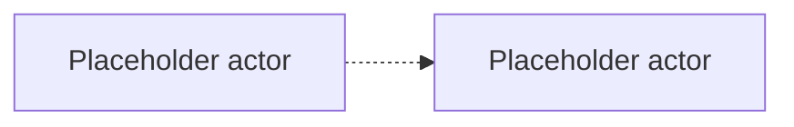

# diagrams

Interaction maps for the Echoes project.

Use this folder for diagrams of relationships and interactions among people, systems, and events, drawn only from sources in `docs/`, `narrative/`, `data/`, and `timeline/`. Do not invent actors or events.

**Suggested format:** [Mermaid](https://mermaid.js.org/) in Markdown (`.md`) so diagrams stay in version control and can be reviewed as text. Exporting SVG or PNG is optional.

Example placeholder (not a real interaction map):

Replace placeholder diagrams only when sources exist.

**Status:** No interaction maps have been added yet. This folder is a placeholder.
