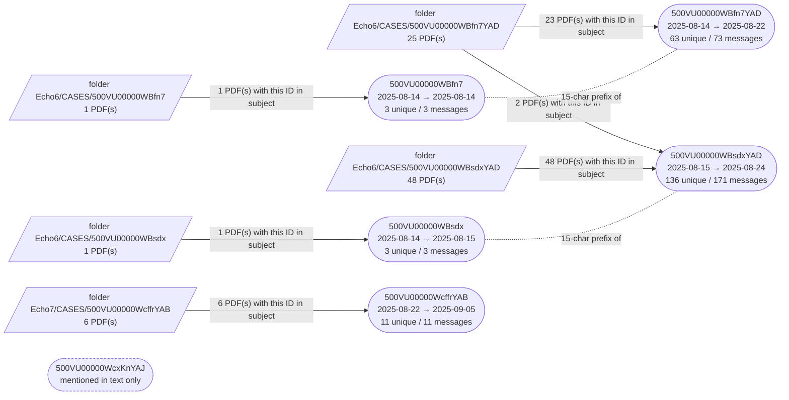

# Case map

Generated by [`analysis/scripts/build_diagrams.py`](../analysis/scripts/build_diagrams.py); do not edit by hand. Regenerate with `python3 analysis/scripts/build_diagrams.py`.

Case IDs found in the archive and the PDFs that carry them. A Case ID is linked to a PDF if it appears in the PDF's subject line (`subject`) or names the `docs/emails/04_LEDGER_ARCHIVE/*/CASES/<ID>/` folder the PDF is filed in (`folder`). Counts cover the union of both. Dates are message timestamps printed in the PDFs (no timezone in the source). Date ranges in the chart end at the last message that is not a broadcast (defined in [`thread-map.md`](thread-map.md)).

## Case IDs with archived PDFs

| Case ID | PDFs with ID in subject | PDFs in its folder | First message | Last message (excl. broadcast) | Last message | Broadcast occurrences | Unique messages | Message occurrences | First mentioned in text |
| --- | --- | --- | --- | --- | --- | --- | --- | --- | --- |
| `500VU00000WBfn7` | 1 | 1 | 2025-08-14 06:45 | 2025-08-14 22:26 | 2025-08-22 04:51 | 1 | 3 | 3 | 2025-08-14 06:45 in [2025-08-14__case-record__echo6-3.pdf](../docs/emails/04_LEDGER_ARCHIVE/Echo6/CASES/500VU00000WBfn7/2025-08-14__case-record__echo6-3.pdf) |
| `500VU00000WBsdx` | 1 | 1 | 2025-08-14 07:45 | 2025-08-15 00:09 | 2025-08-22 04:51 | 1 | 3 | 3 | 2025-08-14 07:45 in [2025-08-14__case-record__echo6-3.pdf](../docs/emails/04_LEDGER_ARCHIVE/Echo6/CASES/500VU00000WBsdx/2025-08-14__case-record__echo6-3.pdf) |
| `500VU00000WBfn7YAD` | 23 | 25 | 2025-08-14 22:29 | 2025-08-22 04:36 | 2025-08-22 04:51 | 23 | 63 | 73 | 2025-08-14 22:29 in [2025-08-14__case-record__echo6-3__part-1.pdf](../docs/emails/04_LEDGER_ARCHIVE/Echo6/CASES/500VU00000WBfn7YAD/2025-08-14__case-record__echo6-3__part-1.pdf) |
| `500VU00000WBsdxYAD` | 50 | 48 | 2025-08-15 00:11 | 2025-08-24 13:50 | 2025-08-24 13:50 | 55 | 136 | 171 | 2025-08-15 00:11 in [2025-08-15__case-record__echo6-3__part-2.pdf](../docs/emails/04_LEDGER_ARCHIVE/Echo6/CASES/500VU00000WBfn7YAD/2025-08-15__case-record__echo6-3__part-2.pdf) |
| `500VU00000WcffrYAB` | 6 | 6 | 2025-08-22 04:23 | 2025-09-05 16:14 | 2025-09-05 16:14 | 0 | 11 | 11 | 2025-08-22 04:20 in [2025-07-19_formal-ledger-handover_echo6-2.pdf](../docs/emails/03_TRANSITION_ARCHIVE/Echo5/2025-07-19_formal-ledger-handover_echo6-2.pdf) |

## Filing differences

PDFs filed in one Case ID folder whose subject names another Case ID (files left as they are):

- [04_LEDGER_ARCHIVE/Echo6/CASES/500VU00000WBfn7YAD/2025-08-15__case-record__echo6-3__part-2.pdf](../docs/emails/04_LEDGER_ARCHIVE/Echo6/CASES/500VU00000WBfn7YAD/2025-08-15__case-record__echo6-3__part-2.pdf): folder `500VU00000WBfn7YAD`, subject `500VU00000WBsdxYAD`
- [04_LEDGER_ARCHIVE/Echo6/CASES/500VU00000WBfn7YAD/2025-08-16__case-record__echo6-3__part-9.pdf](../docs/emails/04_LEDGER_ARCHIVE/Echo6/CASES/500VU00000WBfn7YAD/2025-08-16__case-record__echo6-3__part-9.pdf): folder `500VU00000WBfn7YAD`, subject `500VU00000WBsdxYAD`

## Case IDs mentioned in message text but with no archived thread

| Case ID | First mention | In |
| --- | --- | --- |
| `500VU00000WcxKnYAJ` | 2025-08-22 05:08 | [2025-08-22__case-record__echo7__part-2.pdf](../docs/emails/04_LEDGER_ARCHIVE/Echo7/CASES/500VU00000WcffrYAB/2025-08-22__case-record__echo7__part-2.pdf) |

Notes:

- Some IDs occur in a 15-character and an 18-character form where the longer one begins with the shorter (dotted `15-char prefix of` link). The archive keeps them in separate folders and they are counted separately here; whether they refer to the same support case is not stated in the archive and is not assumed.
- Echo1–Echo5 threads carry no Case ID in their subjects and are not shown here; see [`thread-map.md`](thread-map.md).
