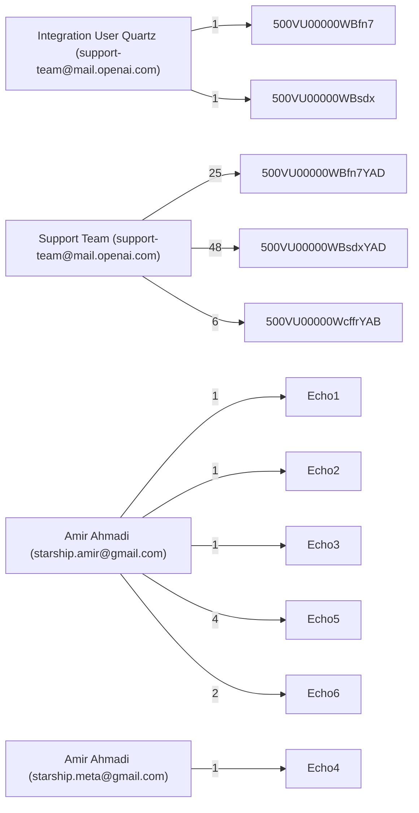

# Interaction map — who opens each archived thread

Generated from [`data/emails.json`](../data/emails.json): an arrow means the **first message** of an archived thread (PDF) was sent by that sender, grouped by Echo folder or Case ID folder. Edge labels are PDF counts (duplicate PDFs in the source are counted). Only the first message of each thread is used; replies inside threads are not counted.

