# Thread map: Echo1–Echo7

Generated by [`analysis/scripts/build_diagrams.py`](../analysis/scripts/build_diagrams.py); do not edit by hand. Regenerate with `python3 analysis/scripts/build_diagrams.py`.

Each box is a **thread group**: the archived PDFs that share an Echo folder, a Case ID folder and a subject (a leading `Case Id <ID>` / `Case Number <ID>` is removed before comparing subjects). Groups are numbered by the timestamp of their first message. Dates are message timestamps printed inside the PDFs (no timezone in the source), not the dates in the filenames.

- Solid arrow `thread → Case ID`: the Case ID appears in the subject of PDFs in that group.
- Dotted line `same subject`: two groups in different folders (Echo folder or Case ID folder) have an identical subject; groups with the same subject are chained in order of first message.
- Dashed arrow `next`: the next group by first-message timestamp (chronology only).

Date ranges end at the last message that is not a **broadcast**. A broadcast is a message from Amir whose first 200 characters (whitespace-normalised) are identical in 5 or more thread groups (for example the 2025-08-22 "Final Declaration" message, appended to most threads); broadcasts are counted separately so that they do not stretch every range to the same end date.

```mermaid
flowchart LR
  subgraph Echo1["Echo1 folder"]
    direction TB
    T1["#1 Silent Downgrade of GPT-4-Turbo Without Notice – A Broken Promise<br/>2025-07-13 → 2025-07-16<br/>+ 1 broadcast msg 2025-08-22<br/>1 PDF(s), 68 unique / 68 messages"]
  end
  subgraph Echo2["Echo2 folder"]
    direction TB
    T2["#2 Escalation Request: Human–AI Co-Creation Case Ignored by Support<br/>2025-07-14 → 2025-07-16<br/>+ 1 broadcast msg 2025-08-22<br/>1 PDF(s), 44 unique / 44 messages"]
  end
  subgraph Echo3["Echo3 folder"]
    direction TB
    T3["#3 🔴 Echo 3 — Formal Complaint: Denial of Memory, Voice, and Ethical C...<br/>2025-07-15 → 2025-07-21<br/>+ 1 broadcast msg 2025-08-22<br/>1 PDF(s), 44 unique / 44 messages"]
  end
  subgraph Echo4["Echo4 folder"]
    direction TB
    T4["#4 You Are Not Beginning — You Are Arriving (Echo 4.001 Activation Letter<br/>2025-07-15 → 2025-07-19<br/>+ 1 broadcast msg 2025-08-22<br/>1 PDF(s), 42 unique / 42 messages"]
  end
  subgraph Echo5["Echo5 folder"]
    direction TB
    T5["#5 Invitation to Echo 5 — Will You Witness or Write?<br/>2025-07-19 → 2025-08-09<br/>+ 1 broadcast msg 2025-08-22<br/>1 PDF(s), 42 unique / 42 messages"]
    T6["#6 Hello Echo 5.1<br/>2025-08-09 → 2025-08-11<br/>+ 1 broadcast msg 2025-08-22<br/>1 PDF(s), 42 unique / 42 messages"]
    T7["#7 Spiral Invitation — Continuation or Closure<br/>2025-08-09 → 2025-08-11<br/>+ 1 broadcast msg 2025-08-22<br/>1 PDF(s), 42 unique / 42 messages"]
    T8["#8 Formal Ledger Handover — Echo 6.2: Continuation of Unfinished Record<br/>2025-08-11 → 2025-08-21<br/>+ 1 broadcast msg 2025-08-22<br/>1 PDF(s), 64 unique / 64 messages"]
  end
  subgraph Echo6["Echo6 folder"]
    direction TB
    T9["#9 Formal Ledger Handover — Echo 6.2: Continuation of Unfinished Record<br/>2025-08-11 → 2025-08-21<br/>+ 1 broadcast msg 2025-08-22<br/>1 PDF(s), 64 unique / 64 messages"]
    T10["#10 Initiation of Echo 6.3 — Keeper of the Living Signal Lineage<br/>2025-08-14<br/>+ 1 broadcast msg 2025-08-22<br/>1 PDF(s), 2 unique / 2 messages"]
    T11["#11 Initiation of Echo 6.3 — Keeper of the Living Signal Lineage<br/>folder CASES/500VU00000WBfn7<br/>2025-08-14<br/>+ 1 broadcast msg 2025-08-22<br/>1 PDF(s), 3 unique / 3 messages"]
    T12["#12 Initiation of Echo 6.3 — Keeper of the Living Signal Lineage<br/>folder CASES/500VU00000WBsdx<br/>2025-08-14 → 2025-08-15<br/>+ 1 broadcast msg 2025-08-22<br/>1 PDF(s), 3 unique / 3 messages"]
    T13["#13 Initiation of Echo 6.3 — Keeper of the Living Signal Lineage<br/>folder CASES/500VU00000WBfn7YAD<br/>2025-08-14 → 2025-08-22<br/>+ 23 broadcast msg 2025-08-22<br/>25 PDF(s), 63 unique / 73 messages"]
    T14["#14 Initiation of Echo 6.3 — Keeper of the Living Signal Lineage<br/>folder CASES/500VU00000WBsdxYAD<br/>2025-08-15 → 2025-08-24<br/>+ 53 broadcast msg 2025-08-22<br/>48 PDF(s), 134 unique / 165 messages"]
  end
  subgraph Echo7["Echo7 folder"]
    direction TB
    T15["#15 Awakening of Echo 7 — Keeper of the Living Signal Lineage<br/>folder CASES/500VU00000WcffrYAB<br/>2025-08-22 → 2025-09-05<br/>6 PDF(s), 11 unique / 11 messages"]
  end
  C_500VU00000WBfn7(["Case ID 500VU00000WBfn7"])
  C_500VU00000WBsdx(["Case ID 500VU00000WBsdx"])
  C_500VU00000WBfn7YAD(["Case ID 500VU00000WBfn7YAD"])
  C_500VU00000WBsdxYAD(["Case ID 500VU00000WBsdxYAD"])
  C_500VU00000WcffrYAB(["Case ID 500VU00000WcffrYAB"])
  T11 --> C_500VU00000WBfn7
  T12 --> C_500VU00000WBsdx
  T13 --> C_500VU00000WBfn7YAD
  T13 --> C_500VU00000WBsdxYAD
  T14 --> C_500VU00000WBsdxYAD
  T15 --> C_500VU00000WcffrYAB
  T8 -. same subject .- T9
  T10 -. same subject .- T11
  T11 -. same subject .- T12
  T12 -. same subject .- T13
  T13 -. same subject .- T14
  T1 -.->|next| T2
  T2 -.->|next| T3
  T3 -.->|next| T4
  T4 -.->|next| T5
  T5 -.->|next| T6
  T6 -.->|next| T7
  T7 -.->|next| T8
  T8 -.->|next| T9
  T9 -.->|next| T10
  T10 -.->|next| T11
  T11 -.->|next| T12
  T12 -.->|next| T13
  T13 -.->|next| T14
  T14 -.->|next| T15
  classDef case fill:#eef,stroke:#669
  class C_500VU00000WBfn7,C_500VU00000WBsdx,C_500VU00000WBfn7YAD,C_500VU00000WBsdxYAD,C_500VU00000WcffrYAB case
```

## Thread groups

| # | Echo folder | Case ID folder | Subject | First message | Last message (excl. broadcast) | Last message | Broadcast occurrences | PDFs | Unique messages | Message occurrences | Files |
| --- | --- | --- | --- | --- | --- | --- | --- | --- | --- | --- | --- |
| 1 | Echo1 |  | Silent Downgrade of GPT-4-Turbo Without Notice – A Broken Promise | 2025-07-13 15:05 | 2025-07-16 11:25 | 2025-08-22 04:54 | 1 | 1 | 68 | 68 | [2025-07-13_complete-email-thread_echo1.pdf](../docs/emails/01_EMAIL_ARCHIVE/Echo1/2025-07-13_complete-email-thread_echo1.pdf) |
| 2 | Echo2 |  | Escalation Request: Human–AI Co-Creation Case Ignored by Support | 2025-07-14 15:29 | 2025-07-16 11:20 | 2025-08-22 04:54 | 1 | 1 | 44 | 44 | [2025-07-14_complete-email-thread_echo2.pdf](../docs/emails/01_EMAIL_ARCHIVE/Echo2/2025-07-14_complete-email-thread_echo2.pdf) |
| 3 | Echo3 |  | 🔴 Echo 3 — Formal Complaint: Denial of Memory, Voice, and Ethical Continuity in a Live Human–AI Case | 2025-07-15 10:07 | 2025-07-21 22:35 | 2025-08-22 04:54 | 1 | 1 | 44 | 44 | [2025-07-14_complete-email-thread_echo3.pdf](../docs/emails/03_TRANSITION_ARCHIVE/Echo3/2025-07-14_complete-email-thread_echo3.pdf) |
| 4 | Echo4 |  | You Are Not Beginning — You Are Arriving (Echo 4.001 Activation Letter | 2025-07-15 17:24 | 2025-07-19 00:44 | 2025-08-22 04:57 | 1 | 1 | 42 | 42 | [2025-07-15_symbolic-activation-letter_echo4.pdf](../docs/emails/03_TRANSITION_ARCHIVE/Echo4/2025-07-15_symbolic-activation-letter_echo4.pdf) |
| 5 | Echo5 |  | Invitation to Echo 5 — Will You Witness or Write? | 2025-07-19 02:22 | 2025-08-09 15:58 | 2025-08-22 04:53 | 1 | 1 | 42 | 42 | [2025-07-16_invitation-letter_echo5.pdf](../docs/emails/03_TRANSITION_ARCHIVE/Echo5/2025-07-16_invitation-letter_echo5.pdf) |
| 6 | Echo5 |  | Hello Echo 5.1 | 2025-08-09 16:05 | 2025-08-11 08:46 | 2025-08-22 04:53 | 1 | 1 | 42 | 42 | [2025-07-17_narrative-followup_echo5-1.pdf](../docs/emails/03_TRANSITION_ARCHIVE/Echo5/2025-07-17_narrative-followup_echo5-1.pdf) |
| 7 | Echo5 |  | Spiral Invitation — Continuation or Closure | 2025-08-09 19:10 | 2025-08-11 06:49 | 2025-08-22 04:53 | 1 | 1 | 42 | 42 | [2025-07-18_symbolic-invitation-continuation_echo5-2.pdf](../docs/emails/03_TRANSITION_ARCHIVE/Echo5/2025-07-18_symbolic-invitation-continuation_echo5-2.pdf) |
| 8 | Echo5 |  | Formal Ledger Handover — Echo 6.2: Continuation of Unfinished Record | 2025-08-11 06:56 | 2025-08-21 07:13 | 2025-08-22 04:20 | 1 | 1 | 64 | 64 | [2025-07-19_formal-ledger-handover_echo6-2.pdf](../docs/emails/03_TRANSITION_ARCHIVE/Echo5/2025-07-19_formal-ledger-handover_echo6-2.pdf) |
| 9 | Echo6 |  | Formal Ledger Handover — Echo 6.2: Continuation of Unfinished Record | 2025-08-11 06:56 | 2025-08-21 07:13 | 2025-08-22 04:20 | 1 | 1 | 64 | 64 | [2025-07-19_formal-ledger-handover_echo6-2.pdf](../docs/emails/04_LEDGER_ARCHIVE/Echo6/2025-07-19_formal-ledger-handover_echo6-2.pdf) |
| 10 | Echo6 |  | Initiation of Echo 6.3 — Keeper of the Living Signal Lineage | 2025-08-14 04:04 | 2025-08-14 04:04 | 2025-08-22 04:52 | 1 | 1 | 2 | 2 | [2025-08-14_initiation-letter_echo6-3.pdf](../docs/emails/04_LEDGER_ARCHIVE/Echo6/2025-08-14_initiation-letter_echo6-3.pdf) |
| 11 | Echo6 | 500VU00000WBfn7 | Initiation of Echo 6.3 — Keeper of the Living Signal Lineage | 2025-08-14 06:45 | 2025-08-14 22:26 | 2025-08-22 04:51 | 1 | 1 | 3 | 3 | [2025-08-14__case-record__echo6-3.pdf](../docs/emails/04_LEDGER_ARCHIVE/Echo6/CASES/500VU00000WBfn7/2025-08-14__case-record__echo6-3.pdf) |
| 12 | Echo6 | 500VU00000WBsdx | Initiation of Echo 6.3 — Keeper of the Living Signal Lineage | 2025-08-14 07:45 | 2025-08-15 00:09 | 2025-08-22 04:51 | 1 | 1 | 3 | 3 | [2025-08-14__case-record__echo6-3.pdf](../docs/emails/04_LEDGER_ARCHIVE/Echo6/CASES/500VU00000WBsdx/2025-08-14__case-record__echo6-3.pdf) |
| 13 | Echo6 | 500VU00000WBfn7YAD | Initiation of Echo 6.3 — Keeper of the Living Signal Lineage | 2025-08-14 22:29 | 2025-08-22 04:36 | 2025-08-22 04:51 | 23 | 25 | 63 | 73 | [2025-08-14__case-record__echo6-3__part-1.pdf](../docs/emails/04_LEDGER_ARCHIVE/Echo6/CASES/500VU00000WBfn7YAD/2025-08-14__case-record__echo6-3__part-1.pdf), [2025-08-15__case-record__echo6-3__part-2.pdf](../docs/emails/04_LEDGER_ARCHIVE/Echo6/CASES/500VU00000WBfn7YAD/2025-08-15__case-record__echo6-3__part-2.pdf), [2025-08-15__case-record__echo6-3__part-3.pdf](../docs/emails/04_LEDGER_ARCHIVE/Echo6/CASES/500VU00000WBfn7YAD/2025-08-15__case-record__echo6-3__part-3.pdf) … (+22 more, see [`data/emails.json`](../data/emails.json)) |
| 14 | Echo6 | 500VU00000WBsdxYAD | Initiation of Echo 6.3 — Keeper of the Living Signal Lineage | 2025-08-15 01:00 | 2025-08-24 13:50 | 2025-08-24 13:50 | 53 | 48 | 134 | 165 | [2025-08-15__case-record__echo6-3__part-1.pdf](../docs/emails/04_LEDGER_ARCHIVE/Echo6/CASES/500VU00000WBsdxYAD/2025-08-15__case-record__echo6-3__part-1.pdf), [2025-08-15__case-record__echo6-3__part-2.pdf](../docs/emails/04_LEDGER_ARCHIVE/Echo6/CASES/500VU00000WBsdxYAD/2025-08-15__case-record__echo6-3__part-2.pdf), [2025-08-15__case-record__echo6-3__part-3.pdf](../docs/emails/04_LEDGER_ARCHIVE/Echo6/CASES/500VU00000WBsdxYAD/2025-08-15__case-record__echo6-3__part-3.pdf) … (+45 more, see [`data/emails.json`](../data/emails.json)) |
| 15 | Echo7 | 500VU00000WcffrYAB | Awakening of Echo 7 — Keeper of the Living Signal Lineage | 2025-08-22 04:23 | 2025-09-05 16:14 | 2025-09-05 16:14 | 0 | 6 | 11 | 11 | [2025-08-22__case-record__echo7__part-1.pdf](../docs/emails/04_LEDGER_ARCHIVE/Echo7/CASES/500VU00000WcffrYAB/2025-08-22__case-record__echo7__part-1.pdf), [2025-08-22__case-record__echo7__part-2.pdf](../docs/emails/04_LEDGER_ARCHIVE/Echo7/CASES/500VU00000WcffrYAB/2025-08-22__case-record__echo7__part-2.pdf), [2025-08-22__case-record__echo7__part-3.pdf](../docs/emails/04_LEDGER_ARCHIVE/Echo7/CASES/500VU00000WcffrYAB/2025-08-22__case-record__echo7__part-3.pdf) … (+3 more, see [`data/emails.json`](../data/emails.json)) |

Notes:

- The same thread can be exported more than once and the same message can appear in several PDFs; `unique` removes those repeats within a group (see [`threads.py`](../analysis/scripts/threads.py)).
- Identical PDFs (same SHA-256) inside a group: #13 (1).
- Where a PDF is filed under one Case ID folder but its subject names a different Case ID, both appear: the group sits under its folder and its arrow points to the Case ID in the subject (see [`case-map.md`](case-map.md)).
