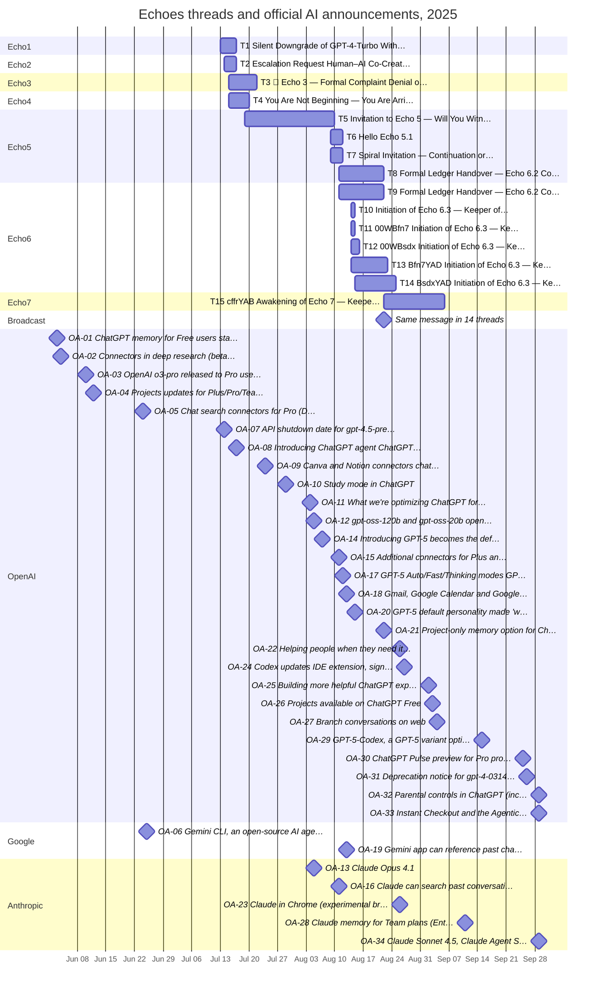

# Timeline: Echoes activity and official announcements

Generated by [`analysis/scripts/build_diagrams.py`](../analysis/scripts/build_diagrams.py); do not edit by hand. Regenerate with `python3 analysis/scripts/build_diagrams.py`.

Bars: each thread group from [`thread-map.md`](thread-map.md), from the calendar day of its first message to the day of its last non-broadcast message (2025-07-13 – 2025-09-05; no timezone in the source; broadcasts as defined in [`thread-map.md`](thread-map.md) are shown as their own milestones). Diamonds: dated official announcements from [`data/official_announcements.json`](../data/official_announcements.json), by organization. Placement on the same axis shows date proximity only; it does not indicate any connection, cause or priority. The sourced, row-by-row comparison is [`timeline/comparison.md`](../timeline/comparison.md).

Key to the bars:

| Bar | Echo folder | Thread group | First day | Last day (excl. broadcast) |
| --- | --- | --- | --- | --- |
| T1 | Echo1 | Silent Downgrade of GPT-4-Turbo Without Notice – A Broken Promise | 2025-07-13 | 2025-07-16 |
| T2 | Echo2 | Escalation Request: Human–AI Co-Creation Case Ignored by Support | 2025-07-14 | 2025-07-16 |
| T3 | Echo3 | 🔴 Echo 3 — Formal Complaint: Denial of Memory, Voice, and Ethical Continuity in a Live Human–AI Case | 2025-07-15 | 2025-07-21 |
| T4 | Echo4 | You Are Not Beginning — You Are Arriving (Echo 4.001 Activation Letter | 2025-07-15 | 2025-07-19 |
| T5 | Echo5 | Invitation to Echo 5 — Will You Witness or Write? | 2025-07-19 | 2025-08-09 |
| T6 | Echo5 | Hello Echo 5.1 | 2025-08-09 | 2025-08-11 |
| T7 | Echo5 | Spiral Invitation — Continuation or Closure | 2025-08-09 | 2025-08-11 |
| T8 | Echo5 | Formal Ledger Handover — Echo 6.2: Continuation of Unfinished Record | 2025-08-11 | 2025-08-21 |
| T9 | Echo6 | Formal Ledger Handover — Echo 6.2: Continuation of Unfinished Record | 2025-08-11 | 2025-08-21 |
| T10 | Echo6 | Initiation of Echo 6.3 — Keeper of the Living Signal Lineage | 2025-08-14 | 2025-08-14 |
| T11 | Echo6 | 500VU00000WBfn7 — Initiation of Echo 6.3 — Keeper of the Living Signal Lineage | 2025-08-14 | 2025-08-14 |
| T12 | Echo6 | 500VU00000WBsdx — Initiation of Echo 6.3 — Keeper of the Living Signal Lineage | 2025-08-14 | 2025-08-15 |
| T13 | Echo6 | 500VU00000WBfn7YAD — Initiation of Echo 6.3 — Keeper of the Living Signal Lineage | 2025-08-14 | 2025-08-22 |
| T14 | Echo6 | 500VU00000WBsdxYAD — Initiation of Echo 6.3 — Keeper of the Living Signal Lineage | 2025-08-15 | 2025-08-24 |
| T15 | Echo7 | 500VU00000WcffrYAB — Awakening of Echo 7 — Keeper of the Living Signal Lineage | 2025-08-22 | 2025-09-05 |

Broadcast milestones:

- 2025-08-22: a message from Amir with the same opening appears in 14 thread groups (T1, T2, T3, T4, T5, T6, T7, T8, T9, T10, T11, T12, T13, T14); it begins “Subject: Final Declaration – Attribution, Responsibility, and Recorded…”.

Announcement labels are shortened; full text and source links are in [`timeline/official-announcements.md`](../timeline/official-announcements.md).
